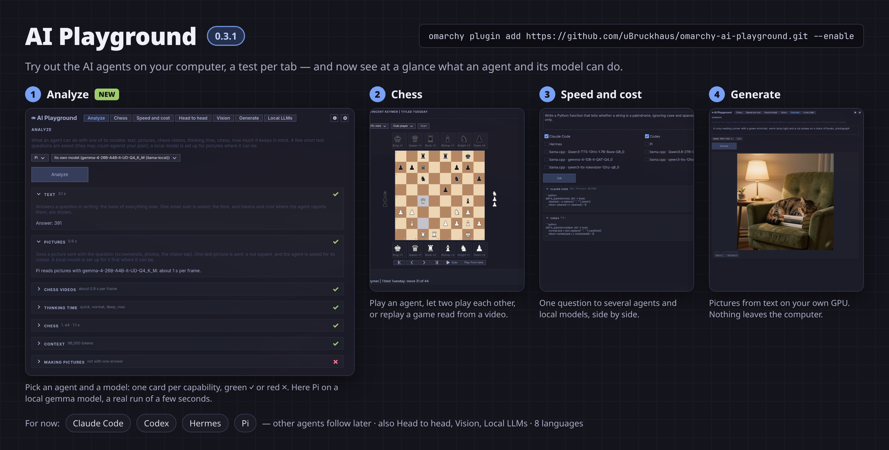

# AI Playground

Try out the AI agents on your computer, one test per tab: see at a glance what an agent and its
model can do, play chess against Claude Code, Codex, Hermes or Pi (or let two of them play each
other), compare their speed and cost, judge two answers blind, test what they see in a picture, make
pictures from a text on your own graphics card, and ask your local LLMs with their tokens per second.

**For now AI Playground works with four agents: Claude Code, Codex, Hermes and Pi.** Other agents
(OpenCode, Gemini CLI, …) follow in later versions. It goes with
[AI Agents Map](https://github.com/uBruckhaus/omarchy-ai-agents-map), which shows and changes how the
agents are set up; AI Playground only asks them. It works on its own: AI Agents Map is not needed
and nothing of it is run. When it is installed, the models folder you set there is also searched
when AI Playground estimates whether two local models fit in GPU memory together.



## Install

```sh
omarchy plugin add https://github.com/uBruckhaus/omarchy-ai-playground.git --enable
```

A gamepad button appears in the bar. It opens AI Playground, brings it to the front, or closes it
when it is already the window in front. It is a normal app window: Hyprland tiles or floats it,
Alt+Tab and workspaces work, and closing the window quits it.

Requires Python with PyGObject, GTK4 and libadwaita in an Omarchy/Hyprland session; all come with a
standard Omarchy install. The tests use the agents you have installed and signed in to (for now Claude
Code, Codex, Hermes and Pi); AI Playground installs none of them. Optional tools, each only for
the feature named: `yt-dlp`, `ffmpeg` and `ffprobe` (reading a chess game from a video), `grim`
(Screenshot on the Vision tab), `curl` (setting up Generate).

## The tabs

- **Analyze**: pick an agent and one of its models (its own, or another one it lists, local models
  included). One card per capability (text, pictures, chess videos, thinking time, chess, how much it
  keeps in mind, making pictures) with a big mark at the end of its heading: green ✓ can, red ✗
  cannot, yellow ! only slowly, ? not stated. A few short test questions are asked (a small sum, a
  red test square, one opening move); the rest is read from the agent's own settings and model lists
  (`pi --list-models`, Codex's `models_cache.json`). Changing the agent or model clears the cards.
- **Chess**: play against an agent, or let two agents (or two local models) play each other, each
  with its own strength. The board checks every move; an agent that answers with an illegal move is
  asked again. Games can be saved, replayed move by move beneath the board, renamed and saved as PGN.
  **Read a game from a video**: drop a video file or a YouTube link on the tab (or paste a link
  with Ctrl+V). The fast way reads the moves from the video's description and captions; the slow way
  shows frames to an agent that can see. The moves are checked for legality before they are kept.
- **Speed and cost**: one question to several agents (and local models); their answers side by side
  with time, tokens and cost where the agent reports them.
- **Head to head**: one question to two agents or local models. You pick the better answer; in
  **Blind** mode you see who wrote which only afterwards. The score is kept.
- **Vision**: a picture, a screenshot or four frames of a video, for the agents that can see (Claude
  Code, Codex, Pi). **Clear** removes the pictures. Pictures are scaled down and saved again first,
  so no photo metadata goes out.
- **Generate**: a picture from a text, made on this computer's graphics card with
  [stable-diffusion.cpp](https://github.com/leejet/stable-diffusion.cpp) and the
  [Z-Image-Turbo](https://huggingface.co/leejet/Z-Image-Turbo-GGUF) model. Nothing leaves the computer.
  The first time, **Set up** downloads the program (about 40 MB) and the model with its text encoder
  (about 11 GB); see Privacy below. A 1024 × 1024 picture takes about 20 s on a 24 GB card.
  **Save as…** keeps a picture, **Ask about it** hands it to the Vision tab.
- **Local LLMs**: one question to a model of a local LLM server running on this computer (llama.cpp,
  Ollama, LM Studio, vLLM, Jan, KoboldCpp), with its time and tokens per second, optionally compared
  with a second model. When two local models would answer at once and might not fit in the graphics
  card's memory together, you are asked first.

Ctrl+1 … Ctrl+7 switch tabs; Ctrl+, opens the settings (language, text size in the choice boxes,
whether several local models may run at once). AI Playground speaks English, German, French,
Spanish, Italian, Portuguese, Dutch and Polish.

## How the agents are asked

Each agent is started once per question, the way its own command line offers for one prompt and one
answer, **without tools**: `claude -p --tools ""`, `codex exec --sandbox read-only`, `hermes -z` with
only its in-memory task list, `pi -p --no-tools`, and so on. It runs in an empty private folder
(created `0700`, deleted afterwards), with a time limit, and its answer is read with a size limit.
Pictures are copied into that folder first and given to the agent the way it takes them (stdin for
Claude Code, `-i` for Codex, `@file` for Pi). Claude Code and Codex get the question on stdin; the
others take it only as a command-line argument, which other accounts on the computer can see while
the agent runs. Every program is started as an argv list, never through a shell. The agents send the
question to their own providers as they always do; AI Playground adds nothing.

A video's description, captions and frames come from the web, so they go only to an agent that runs
with no tools at all (Claude Code with `--tools "" --strict-mcp-config`, Pi with `--no-tools`, Hermes
with only its task list): words planted in a video cannot make it read your files. Codex is left out
of reading videos, because its read-only sandbox still lets it read files.

## Privacy and capabilities

- AI Playground never asks for root or administrator rights and never reads credential files.
- **Settings and saved games** are kept in `~/.config/omarchy/ai-playground/` (`settings.json`,
  `games.json`), written atomically and readable only by you.
- **Local LLMs**: only servers whose listening port belongs to a process of your own account are
  asked (checked in `/proc/net/tcp` before any request); every reply is read with a size limit and
  one overall deadline, and model names are shown as plain text.
- **Chess from a video**: a YouTube link is passed to `yt-dlp` after `--`, with `--ignore-config` and
  `--no-exec`; the video goes into a private temporary folder that is deleted afterwards. `ffmpeg` and
  `ffprobe` read only local files in a real video container (`-protocol_whitelist file` and a format
  whitelist, so a playlist renamed `.mp4` cannot make them fetch addresses or read other files), under
  a 4 GiB memory limit, bounded in time and output.
- **Drops and pastes**: a dropped link or file, Ctrl+V on the chess tab and pasting into any text
  field are read with a byte limit and a deadline (`wl-paste`), never by GTK's own unbounded reading.
- **Pictures** you pick, screenshots and video frames are checked by the size their header declares
  (at most 16384 pixels per side, 64 megapixels) before anything decodes them, and decoded off the
  window's thread.
- **Generate** downloads, on **Set up** only:
  - stable-diffusion.cpp's newest Linux Vulkan build from its GitHub releases. The release lists a
    SHA-256 for the file; without one nothing is downloaded, and the file is kept only when its bytes
    match. The zip is unpacked into `~/.local/share/ai-playground/sd/<release>/` only if it holds
    plain files (no folders, links or odd names), and `sd-cli` from there is what makes the pictures.
  - three model files from Hugging Face (Apache-2.0, not gated), each pinned in the code by size
    and SHA-256 and kept only when both match, in `~/.local/share/ai-playground/models/z-image-turbo/`.
  - Downloads go to a `.part` file opened exclusively and never through a link, with one download per
    file at a time; a cancelled download resumes. Closing the window stops any download or picture
    still running. `sd-cli` is started as an argv list with the prompt as one argument; its output is
    read with a size limit and a 15-minute deadline. Pictures stay in a private temporary folder until
    the app closes.
- **Local models and pictures** (Analyze, and reading a chess video with an agent on a local
  model), only after a click on **Analyze** or **Read**:
  - a llama.cpp model whose section in `~/.config/llama.cpp/models.ini` has no vision file gets an
    `mmproj = …` line for one already beside the model's file — only a plain file of your own, in a
    folder only you can write to. Without one, the model's Hugging Face repository is asked for its
    vision file, and **Download the vision file** (size shown) fetches it beside the model into an
    exclusive `.part` file, checked against its size and the SHA-256 Hugging Face lists, never without
    that click.
  - Pi's entry for that local model in `~/.pi/agent/models.json` gets `"input": ["text", "image"]`,
    and the thinking switch where the model's chat template has one (so it can be asked not to think).
  - A copy of every file is kept first in `~/.local/state/ai-playground/backups/<time>/`; files are
    replaced atomically and keep their permissions.
  - The local LLM's own user service (`llama-server`, `ollama`, …, only units that exist) is started
    with `systemctl --user start` while a test or a video read runs, kept up with a light request
    every 2 s, and stopped again afterwards if AI Playground started it and nothing else is connected.
    After a new vision line llama.cpp is restarted (`systemctl --user restart llama-server.service`)
    only when no program is connected to it; otherwise it reads the line the next time it starts.
- **ⓘ Information** opens fixed `https://plugins.omarchy.org/plugin.html?id=…` addresses in your
  browser on a click.

## Remove

```sh
omarchy plugin remove ubruckhaus.ai-playground
```

To also remove its settings, saved games and the Generate program and model (about 11 GB):

```sh
rm -rf ~/.config/omarchy/ai-playground ~/.local/share/ai-playground
```

## Files

| Path | Purpose |
| --- | --- |
| `manifest.json` | Plugin metadata (bar-widget) |
| `BarWidget.qml` | Bar button: runs `ai-playground --toggle` |
| `ai-playground` | Starts the app (as an app of its own under uwsm) |
| `ai_playground.py`, `host.py` | The GTK4 app window, its tabs, settings and information pages |
| `chess_page.py`, `chess_rules.py`, `chess_agent.py` | The chess tab: board, legal moves, asking an agent for a move |
| `chess_import.py`, `chess_video.py` | Saved games, replay, PGN; reading a game from a video |
| `analyze_tab.py`, `analyze.py`, `online_models.py` | Analyze: the tab; its tests and the facts read from the agents' settings |
| `frame_check.py`, `local_hold.py` | Setting a local model up for pictures; keeping a local LLM up during a job |
| `tabs.py`, `agent_run.py`, `gpu_check.py` | Speed and cost, Head to head, Vision, Local LLMs; asking an agent once; GPU memory check |
| `generate_tab.py`, `picture_gen.py` | Generate: the tab; setting up stable-diffusion.cpp and the model, making a picture |
| `local_llm.py`, `loopback.py`, `netfetch.py` | Local LLM servers of your own account; bounded local HTTP |
| `adapters/` | How each agent is asked (data, shared with AI Agents Map) |
| `ai_core.py`, `desktop*.py`, `theme_css.py`, `palette.py`, `i18n.py`, `translations/` | Shared helpers, desktop and theme, languages |
| `tests/` | Unit tests (`python3 -m unittest discover -s tests`) |
| `LICENSE` | MIT |
